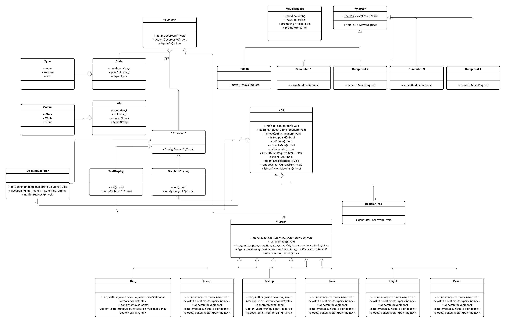

# CS 246 Chess

## Summary

A C++20 chess game developed by Amin, Brian, and Philip for the S25 semester of CS 246 at the University of Waterloo.
It includes text and X11 board displays, human and computer opponents, four computer difficulty levels, custom board setup, and optional opening recognition, undo, and move hints.

## Getting Started

The Makefile uses `g++-14` with C++20 and links against X11.
Install the compiler and X11 development libraries, and run with access to an X server (including X forwarding when connecting remotely).
A graphical display is required even when entering moves in the terminal.

```bash
git clone https://github.com/Brian-An/chess.git
cd chess
make
./chess
# or (for bonus features)
./chess -bonus
```

## Design Decisions



[View the full-resolution UML diagram](docs/chess-architecture.png).

### Separate game state from move analysis

[`Grid`](grid.h) owns the board, displays, opening explorer, and decision tree, while [`main.cc`](main.cc) coordinates commands, turns, and scores.
Move generation and lookahead live in a separate [`DecisionTree`](decisiontree.h) so rule checks, computer players, and the `options` command can use the same move data.
Extracting this responsibility from `Grid` keeps move analysis accessible without making players friends of the board or duplicating rules in each difficulty level.

Each piece implements `generateMoves()` for candidate destinations and `requestLoc()` for squares that must be clear along the path.
The decision tree combines these with board bounds, occupancy, and king-safety checks.
This keeps piece-specific movement separate from checks that depend on the whole position.
`Grid::move()` accepts a request only when it matches a child of the current tree, and checkmate and stalemate detection also use that tree's check status and available moves.

### Update displays through observers

[`Piece`](piece.h) inherits from [`Subject`](subject.h), and each piece can notify the text display, X11 display, and opening explorer about changes.
Observers receive piece information and an add, move, or remove event, allowing each consumer to update its own representation without putting rendering or opening lookup inside the piece classes.

During lookahead, `DecisionTree` temporarily applies moves to the shared board and restores the pieces afterward.
It suppresses observer notifications for these hypothetical moves, avoiding unnecessary redraws and preventing the opening explorer from recording search branches as played moves.
This avoids copying a full board for every node, at the cost of requiring careful restoration of the shared state.

### Use one interface for human and computer players

[`Player::move()`](player.h) returns a [`MoveRequest`](moverequest.h) containing the starting square, destination, and optional promotion choice.
The `make_player()` factory in `main.cc` selects a human or one of four computer implementations.
The turn loop then requests a move through the same interface and delegates validation and execution to `Grid`.
Returning a move request keeps a player's choice separate from the board changes needed to execute captures, castling, en passant, and promotion.

### Share the tree across four computer strategies

- **Level 1:** Selects a random available move.
- **Level 2:** Scores captures and checks preferentially, falling back to a random move when all scores are neutral.
- **Level 3:** Uses weighted random selection that favours captures, checks, and moves with less exposure to capture.
- **Level 4:** Recursively evaluates captures, promotions, checks, and mates using configurable scoring constants in [`computerl4.cc`](computerl4.cc).

Level 4 chooses the highest-scoring root move and alternates between subtracting an average opponent-reply score and the best continuation score.
The average includes only nonzero scores and uses integer arithmetic, so its opponent model is heuristic rather than standard minimax.
This makes piece values and tactical preferences easy to experiment with, while allowing an opponent's strongest reply to be underestimated.
The search depth is controlled by `MAX_LEVEL` in `decisiontree.h`, currently `3`; increasing it explores more continuations but grows the tree and increases computation.

### Recognize openings from coordinate move history

[`OpeningExplorer`](openingExplorer.cc) converts observed moves into UCI coordinate strings such as `e2e4` and binary-searches the sorted sequences in [`opening-moves.tsv`](opening-moves.tsv).
UCI maps directly to the program's start and end squares, avoiding the captures, disambiguation, and check notation involved in parsing PGN.
PGN, opening names, and ECO codes remain available as display metadata.
If a sequence has no exact match, the explorer retains the last recognized opening.
Recognition follows move history, so different sequences reaching the same board position are not automatically treated as the same opening.

### Store compact snapshots for undo

`Grid` records piece placement as a 64-character string after each move, with piece letters encoding type and colour and `-` encoding an empty square.
Undo compares consecutive snapshots, reconstructs changed squares, and rebuilds the decision tree.
This supports repeated undo without retaining a complete graph of piece and display objects for every turn, with history storage growing linearly with the number of moves.
The snapshot format stores placement only: movement flags, en passant history, and the opening explorer's history are not restored.

## 🕹️ Command Reference

### `game <white-player> <black-player>`

- **Arguments:** `<white-player>`, `<black-player>` - Either `human` or `computer[1-4]`
- **Pre-requisite:** None
- **Functionality:** Starts the game.

---

### `resign`

- **Pre-requisite:** Game must be started
- **Functionality:** Resigns from the current game.

---

### `move <optional:start> <optional:end>`

- **Arguments:** `start`, `end` - Starting and ending squares of the move
- **Pre-requisite:** Game must be started
- **Functionality:**
  - For **human** players: Both `start` and `end` are required.
  - For **computer** players: Just use `move` with no arguments.

---

### `setup`

- **Pre-requisite:** Game must **not** be started
- **Functionality:** Enters setup mode for a custom game.
  Use `game` to begin play once setup is complete.

---

### `+ <type> <loc>`

- **Pre-requisite:** Setup mode must be active
- **Functionality:** Adds a piece of type `<type>` at location `<loc>`. Replaces any existing piece.

---

### `- <loc>`

- **Pre-requisite:** Setup mode must be active
- **Functionality:** Removes the piece at `<loc>`. Does nothing if the square is already empty.

---

### `= <col>`

- **Arguments:** `<col>` - Either `white` or `black`
- **Pre-requisite:** Setup mode must be active
- **Functionality:** Sets which player starts.
  White moves first unless changed with this command.

---

### `done`

- **Pre-requisite:** Setup mode must be active
- **Functionality:** Finalizes the setup.
  Will not proceed if the board is invalid.

---

## 🌟 Bonus Features

### `bonus-check`

- **Pre-requisite:** None
- **Functionality:** Displays whether bonus mode is active. Enable it by running the executable with the `-bonus` flag.

---

### `options <loc>`

- **Pre-requisite:** Bonus mode must be active and game must be started
- **Functionality:** Displays all valid moves from `<loc>`, only if it's the current player's turn.

---

### `opening`

- **Pre-requisite:** Bonus mode must be active and game must be started
- **Functionality:** Identifies the current opening based on move history.

---

### `undo`

- **Pre-requisite:** Bonus mode must be active and game must be started
- **Functionality:** Reverts the last move.
  Repeat the command to undo multiple moves.

## Copyright

- `opening-moves.tsv` uses opening data gathered from [lichess-org/chess-openings](https://github.com/lichess-org/chess-openings) under CC license.
- All piece images (under `piecesImgBits.h`) are from [Wikimedia Commons](https://commons.wikimedia.org/wiki/Category:PNG_chess_pieces/Standard_transparent) under CC license.
